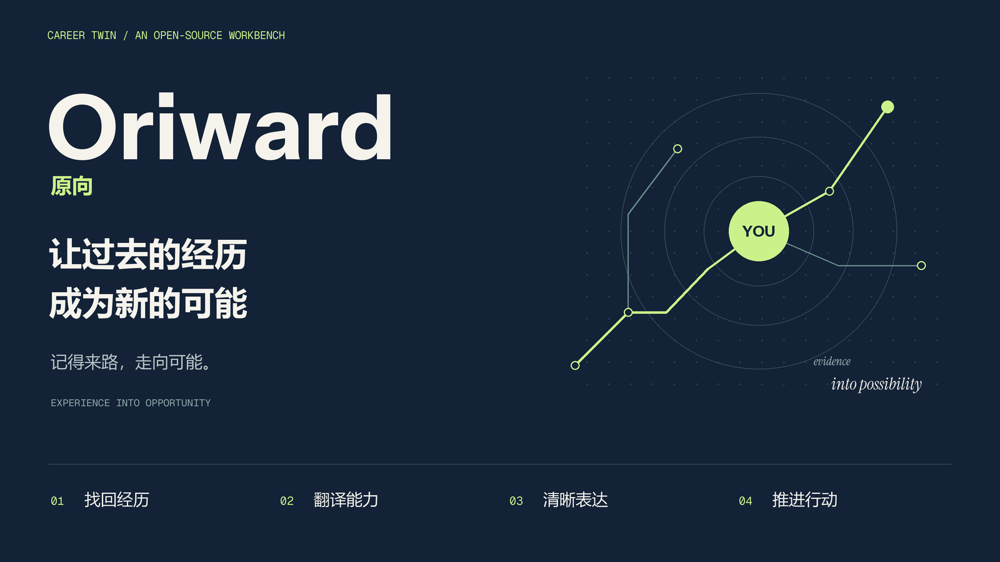
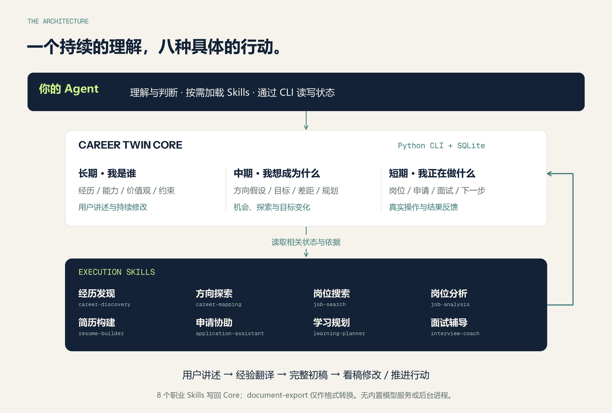
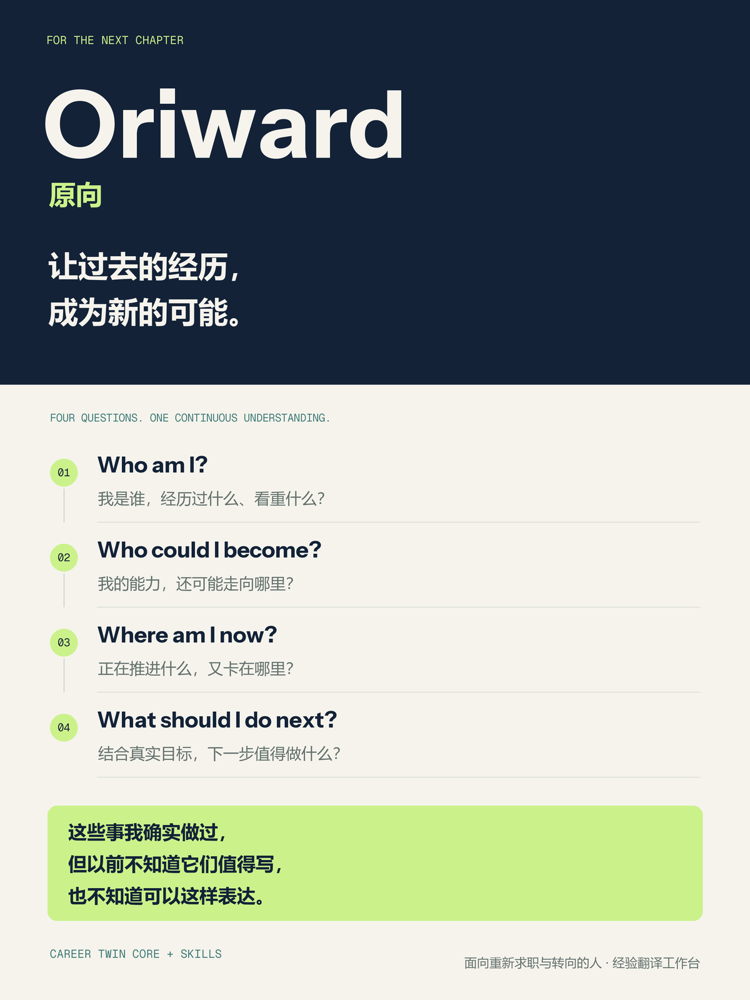

<p align="center"></p>

<h1 align="center">Oriward · 原向</h1>
<p align="center"><strong>记得来路，走向可能。</strong></p>
<p align="center">让过去的经历，成为新的可能。</p>
<p align="center"><strong>这些事我确实做过，但以前不知道它们值得写，也不知道可以这样表达。</strong></p>
<p align="center">这是 Oriward 希望带来的体验：通过对话找回经历、发现价值，把真实积累写成别人看得懂的简历。</p>
<p align="center">帮助经历丰富、正在重新求职或转向的人，通过对话找回经历、识别可迁移能力，把过去的积累转化为现在能表达、能验证、能行动的职业机会。</p>
<p align="center">Python 3.10+ · SQLite · Local-first · 8 个职业 Skills + 1 个导出 Skill · MIT</p>

> 做过很多事情，却不知道哪些仍有价值、能用于什么工作，以及怎样让别人理解。

**Oriward 以“经验翻译”为核心：找回经历，识别可迁移能力，用新岗位能理解的语言表达，再把差距变成可执行的小任务。** 它以 Career Twin Core 保存有来源、可纠正的用户状态，用 Skills 完成具体流程，再把选择与结果带回 Core。当前为 **v0.4.0 Beta**，采用 Agent + Python CLI + SQLite 的形态。

本版支持普通自述直接入库、无逐条审批的简历草稿、完整履历补全、同阶段经历整合、通用简历及本地 DOCX/PDF 预览。用户先看完整稿，再提出修改。每个岗位保留当前 Markdown 加三个历史版本，来源和修改历史在后台保留。已有参考模板可以复用，定制时读取相关经历详情，围绕岗位改写表述；DOCX/PDF 保留栏目、时间和项目链接。市场适配和就业效果仍需真实使用验证；运行流程见 [WORKFLOWS](docs/WORKFLOWS.md)，改造记录见 [CHANGELOG](CHANGELOG.md)。

[开始使用](#开始使用) · [理解架构](#为什么是-career-twin-core--skills) · [如何解释建议](#为什么建议我先做这件事) · [进展与下一步](#已经做了什么还要改进什么)

## 从一个求职者的问题开始

一个人可能工作过很多年、经营过小店，或者在生活变化后重新求职。难点常常是经历零散、表达停留在旧行业，或不知道日常做过的事能否支持新的工作。

| 我遇到的问题 | 我希望得到的帮助 | Oriward 的做法 |
| --- | --- | --- |
| 经历很多，但从头打字整理很费力 | 边聊边找回来 | 先建立简略经历和时间线，再按需要补充；可暂停接续 |
| 以前做过的事情似乎与新岗位不相关 | 找出可以迁移的能力 | 从实际动作、方法和职责连接新岗位的核心交付 |
| 简历写得空、断断续续，已有教育还会遗漏 | 得到一份完整、自然的简历 | 保留主要职业阶段，重点展开，其他简述，补入已有教育信息 |
| AI 总让我重复确认、提供证明 | 先看到完整稿，再具体修改 | 用户讲述即可使用，正常包装直接完成，来源记录留在后台 |
| 旧经验结合新工具可能有机会，但不知道怎么开始 | 找到小而具体的下一步 | 对照真实岗位，安排有产出、有时间预算的实践任务 |

比如，用户说“我以前负责进货和处理客诉”，对话可以帮助找回补货安排、供应商协调和客户沟通的具体做法，再把这些工作转译给新岗位。不能凭空增加成本下降百分比，也不应因为没有精确指标就把这段经历删掉。

先理解，再表达，再分配篇幅。中年再求职者是重点关注对象，但不以年龄划定资格；有长期工作经历的人和经历零散、离岗后回归的人将共同参与后续需求验证。录用结果不等于个人价值。

## 四个长期问题，以及每次都该追问的第五个

| 问题 | 系统需要和我一起弄清什么 |
| --- | --- |
| **Who am I?** 我是谁？ | 经历过什么、做过什么、擅长什么、看重什么，有哪些真实约束？ |
| **Who could I become?** 我可能成为什么？ | 哪些职业值得探索？能力能迁移到哪里？还缺哪些证据或实践？ |
| **Where am I now?** 我现在在哪里？ | 在研究、申请、面试哪些岗位？哪些材料正在修改？哪里卡住了？ |
| **What should I do next?** 下一步做什么？ | 结合真实目标、偏好、时间与机会，下一步值得投入的行动是什么？ |
| **Why do you think so?** 为什么这样认为？ | 判断来自哪段经历、哪个岗位要求和哪次反馈？为什么与上次不同？ |

第五个问题贯穿前四个问题。“你适合做产品”应该能够展开为支持它的经历、尚未验证的推断、可能的反证，以及下一步验证方法。

## 为什么是 Career Twin Core + Skills

求职同时包含两类工作：持续理解一个人，以及完成眼前的一件事。整理经历、搜索岗位、写简历和练习面试可以分工，但它们需要共享同一份经过校准的上下文。

**Core 负责让理解连续，Skills 负责让行动具体。**



- **你的 Agent：理解与判断。** 阅读材料、访谈、解释岗位、提出方向，按任务加载 Skills；语义推理发生在宿主 Agent 中。
- **Career Twin Core：保存与校验。** Python CLI + SQLite 保存断言、来源、版本、目标、流水线、行动与决策快照，检查引用、状态和依据变化。
- **Skills：把方法落到任务。** 约定需要读取哪些上下文、如何执行、输出什么，以及将哪些结果通过 CLI 写回。收集到的反馈成为下一轮理解的输入。

写简历时复用用户已经讲述的经历，练面试时延续同一岗位的核心交付，复盘时回到当时的目标和约束。Skills 的产出要由 Agent 在整理对话时通过 CLI 保存才成为持久状态；只聊天而不执行保存不会自动入库。

### 三个时间尺度

这些是状态的组织方式，不是三个独立模型，也没有固定频率的后台更新。

| 时间尺度 | 保存什么 | 什么会促使更新 |
| --- | --- | --- |
| **长期 · 我是谁** | 经历、能力证据、价值观、偏好、职业约束及其来源 | 访谈、新证据、实际反馈与用户确认；允许纠正、质疑和撤回 |
| **中期 · 我想成为什么** | 职业方向假设、阶段目标、能力差距与学习规划 | 新机会、探索结果、目标和资源变化 |
| **短期 · 我正在做什么** | 目标岗位、投递、简历版本、面试、学习任务、阻塞与下一步 | 每次真实操作及结果反馈，经 Agent 或用户执行 CLI 保存 |

面试反馈首先属于一个具体情境；形成足够依据并经用户认可后，才可能成为长期认识。短期挫折不应直接变成“我不擅长这件事”的永久标签。

### 八个职业 Skills，共享一个 Core

| Skill | 我能用它做什么 |
| --- | --- |
| [career-discovery](.agents/skills/career-discovery/SKILL.md) | 从工作、经营、项目及生活责任中找回经历与迁移线索 |
| [career-mapping](.agents/skills/career-mapping/SKILL.md) | 探索相邻职业与跨行业迁移，设计低成本验证 |
| [job-search](.agents/skills/job-search/SKILL.md) | 搜索或导入岗位，保留来源、时间和渠道执行报告 |
| [job-analysis](.agents/skills/job-analysis/SKILL.md) | 理解岗位核心交付，对照已有证据、门槛和缺口 |
| [resume-builder](.agents/skills/resume-builder/SKILL.md) | 围绕具体岗位组织真实经历，保留来源和修订版本 |
| [application-assistant](.agents/skills/application-assistant/SKILL.md) | 准备材料，记录用户实际投递后的进展 |
| [learning-planner](.agents/skills/learning-planner/SKILL.md) | 将差距转成有产出、验收标准和投入预算的任务 |
| [interview-coach](.agents/skills/interview-coach/SKILL.md) | 做公司研究、岗位相关练习，保存实际回答与反馈 |

另有 [document-export](.agents/skills/document-export/SKILL.md)，将已有内容转成 DOCX/PDF；只做格式转换，不确认事实，也不更新 Core 职业状态。

## 为什么建议我先做这件事

为了让 Agent 能解释优先级，需要明确一组可更新的设定。这些可以边做边补，不要求第一次就回答完。

| 要设定或核实的内容 | 它怎样影响下一步 |
| --- | --- |
| **职业目标**：方向、阶段、优先级、成功标准 | 明确行动服务哪个用户目标；Agent 提议不自动成为用户承诺 |
| **偏好与价值观**：工作方式、城市、想获得什么 | 说明为什么考虑这类机会或任务，保留来源与确认状态 |
| **硬约束**：到岗、地点、家庭安排、不能接受的条件 | 与岗位逐条核实；冲突不能被高分抵消，未知项先调查 |
| **能力与经历证据**：做过什么、来源与有效版本 | 将已有支持与待验证的能力假设分开 |
| **外部机会**：岗位原文、来源日期、交付与门槛 | 在真实机会中检验建议；显式保留渠道失败和信息缺失 |
| **资源与行动条件**：每周时间、投入、截止与依赖 | 判断能否推进、是否需要拆小、有没有前置阻塞 |

推荐岗位、方向或投入方案时，一次决定记录六个因素：**目标、偏好、岗位、截止时间、能力、成本**。每项有状态和理由，未知就保留未知；另存硬约束核实、备选方案与当时状态快照。用户选择和后续结果再连接到这个决定。

日程排序参考目标优先级、截止远近、任务类型和预计投入，并展示贡献因素。**它表达排程优先级，不能被解释为岗位适合度或录用概率。** 没有适配评估的普通待办保持 `unassessed`。

### 一个可能的使用过程

> 以下为虚构情境，用于解释工作方式，不是实际求职成绩。

我经营过门店，做过库存记录和供应商协调，想重新求职，但每周只能拿出两小时学习新工具。

Agent 先整理一份完整简历，把实际做过的采购补货与客户服务写清楚；再根据目标岗位，建议用一份脱敏库存表练习分析工具。产出是一份能说明补货依据的小报告，之后根据真实岗位要求检查是否有帮助。准备这个练习不阻碍当前简历完成。

后来，我说“这周家里有事，先暂停”，这首先是**当前约束变化**，不能直接推断为“我不喜欢数据分析”。系统保存我为什么暂停；目标和预算更新后，旧建议需要重评。再后来，我发现自己更愿意做供应商沟通和运营协调，Agent 可以提出新的方向假设，并说明依据是哪次反馈、哪些已有经历，以及还缺什么验证。

### 记住理由，也允许我反悔

系统应能留下这样的线索：**当时怎么认识我 → 为什么提建议 → 有哪些约束与备选 → 我怎样选择 → 后来发生什么 → 哪些新信息改变了判断。**

目前通过断言来源与历史、目标版本、决定快照和结果事件承载这条线索。用户可以确认、修订、质疑或撤回断言；历史保留，当前读取使用有效版本。一次情境信号不会自动升级为长期偏好；周回顾生成提案，经认可后仍需显式写入。读取和评估行动时，Core 会检查相关证据、目标或岗位内容是否改变，将受影响建议标为待复核；旧决定保留，由 Agent 完成重新判断。

保存的是可审查的依据、解释和变化记录。CLI 检查结构、引用与状态，解释的质量仍需要 Agent 判断、真实证据和用户校准。完整约定见 [DECISIONS](docs/DECISIONS.md)。

## 已经做了什么，还要改进什么

为使闭环可运行，当前已将这些部分落到代码、状态契约和隔离演示：

| 已有基础 | 具体落点 |
| --- | --- |
| **可延续的用户认识** | 断言账本、来源与置信状态、修订/撤回、经历稳定 ID 与版本；先读简略索引，再按需展开 |
| **能解释和重评的行动** | 六因素决定、逐项硬约束核实、快照、备选与结果；变化后重评，任务依赖与阻塞单独处理 |
| **从机会到反馈的流程** | 来源与搜索报告、岗位分析、简历修订谱系、模拟评审、人工投递记录、面试和学习反馈 |
| **跨会话接续与工程约束** | 有预算的 `context brief`、当前话题和下一步；SQLite 迁移备份、输入校验、单元测试与虚构 CLI 演示 |

仓库包含自动化测试和两条端到端 CLI 演示，可在隔离目录复现。它们验证状态流转、引用、版本和流程约束；**没有据此验证真实就业效果、推荐准确率或长期画像质量**。搜索和模型能力受宿主与渠道限制，文档生成测试也不能代替逐页视觉检查。

接下来的改进方向：

- **更容易看懂自己的变化。** 提供经历、证据和决策时间线界面，方便检查与纠正；当前主要通过 CLI 与文件读取。
- **验证“理解得对不对”。** 用脱敏、经同意的真实使用和长期回访，评估方向是否有用、建议是否可执行、纠正能否影响后续建议。
- **提高机会信息可靠性。** 持续验证渠道、时效和失败恢复，扩大真实可用覆盖；保留平台和授权边界。
- **让计划符合真实精力。** 改善多任务总负荷与阶段重排；当前 Core 不自动求解整体排程。
- **完善持续运行与数据控制。** 探索授权范围内的提醒、周期回顾，以及更完整的备份、迁移和本地保护；当前没有内置后台进程，Git 忽略也不等于加密。

## 开始使用

主程序需要 **Python 3.10+**，只用标准库，无需先安装项目。先克隆仓库（也可在本页 Code 菜单下载 ZIP）：

```bash
git clone https://github.com/thituongh699-hash/oriward.git
```

在自己的 Agent 工具中打开克隆后的 `oriward` 文件夹，确保工具可以读取本地文件、执行终端命令，然后发送：

```text
请读取 AGENTS.md，按首次使用流程启动 Oriward。
我会从做过的事情开始讲，请边聊边整理经历和时间线，
帮助我发现可迁移的能力，并写出一份完整的简历供我修改。
不用逐条让我批准经历；如果我还没有方向，先整理通用简历，
再提出少量值得探索的方向和具体练习。
如果已有紧急 JD，请先处理它。
```

各宿主的权限、终端和技能发现能力以实际可用情况为准。仅聊天模式不会自动保存资料、搜索实时岗位或提醒任务；项目没有内置模型服务。

从 GitHub 下载 ZIP 后解压整个目录，确认 `.agents/skills/` 也在其中。完整工作流请使用源码；Python wheel 只包含 CLI，不包含九个 Skills。

Python 分发包名为 `oriward-local`，安装后的命令为 `oriward`，源码入口为 `python -m oriward`。名称来自 **Origin + Onward**：从真实的自己出发，在行动与反馈中找到方向。

### 先看一次虚构演示

在项目根运行，`python` 换成已检查的 Python 3.10+ 解释器；各输出目录必须尚不存在：

```bash
python scripts/doctor.py
python scripts/demo_experience_translation.py --output outputs/demo-experience-first
python scripts/demo_twin_lifecycle.py --output outputs/demo-twin-first
python scripts/demo_hiring_loop.py --output outputs/demo-hiring-first
```

经验翻译演示覆盖两类虚构成人履历、自述直接出稿、用户更正、通用稿和 DOCX/PDF 导出（需要安装 `python -m pip install ".[documents]"` 并具备本地中文字体；优先用 Word/LibreOffice，也可用 ReportLab 渲染）；保留全部命令回执。Core 演示覆盖“经历 → 认识 → 目标 → 决定 → 目标变化后重评 → 完成与撤回”，生成 `result.json` 和逐条命令回执；招聘演示覆盖岗位、简历、模拟评审与反馈改版，生成 `REPORT.md`。这些演示使用隔离数据库和虚构材料，不联网、不投递，不验证岗位真实性或渠道可用性。

可查看三套虚构模板预览：[个人参考模板](docs/assets/resume-templates/reference/preview.png)、[现代中文](docs/assets/resume-templates/modern-cn/preview.png)、[简洁无照片](docs/assets/resume-templates/clean/preview.png)。模板决定版式，经历库和目标岗位决定内容。

### 按需深入

| 需要什么 | 入口 |
| --- | --- |
| Agent 规则和技能路由 | [AGENTS.md](AGENTS.md) |
| 首用、招聘闭环与跨会话接续 | [WORKFLOWS](docs/WORKFLOWS.md) |
| 输入结构、版本和状态约束 | [DATA_MODEL](docs/DATA_MODEL.md) |
| 建议依据、用户选择与后续结果 | [DECISIONS](docs/DECISIONS.md) |
| 职位来源和渠道限制 | [CHINA_JOB_SOURCES](docs/CHINA_JOB_SOURCES.md) |
| 猎聘可选扩展配置 | [LIEPIN_INTEGRATION](docs/LIEPIN_INTEGRATION.md) |
| 变更与历史验收边界 | [CHANGELOG](CHANGELOG.md) |

## 数据与使用边界

默认数据库为 `data/private/oriward.sqlite3`，可用 `ORIWARD_DB` 指定固定位置；简历与导出文件在 `outputs/`。wheel 默认在当前工作目录写入数据。本地 CLI 不调用模型服务，但宿主 Agent 读取的材料可能由其模型服务处理。迁移备份不包含全部附件，换机器还需备份文件并核对登记路径。

已有用户的旧默认数据库会原位继续使用，不因改名创建空库；旧前缀的环境设置保留兼容读取，新 `ORIWARD_*` 设置优先（显式关闭也优先）。新的命令和 Python 导入统一使用 `oriward`。历史产物保留原记录，不批量改写个人数据。

项目不代投、不登录账号、不联系招聘方、不绕过验证码；用户亲自提交后才记录投递事实。来源时间不代表岗位仍开放；A–D 是本地模拟标签，不是雇主结论或录用概率。可选扩展默认关闭，接入须遵守平台规则与授权范围。

安全问题请勿在公开 issue 中披露可复现细节；请先只请求维护者的私下沟通渠道，并在获得渠道前保持谨慎披露。项目尚未建立独立的安全响应流程。公开 issue、PR 和示例请使用脱敏或虚构资料。

## 开发与许可

维护规则见 [AGENTS.md](AGENTS.md)。运行 `python -m unittest discover -s tests -v`；验证导出需安装可选 `.[documents]`。欢迎围绕体验、渠道兼容与可复现问题反馈，注明宿主、Python 版本与脱敏复现步骤。

采用 [MIT 许可证](LICENSE)。第三方接口、数据与商标归原所有者；项目许可证不授予平台访问许可。

<p align="center"></p>
