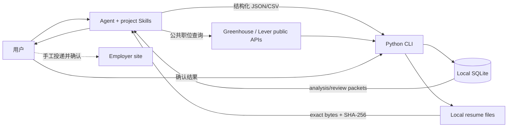

# Architecture · Agent 负责语义，CLI 负责约束

## 责任边界

CareerOS 的推理与编排由用户选择的大模型 Agent 承担，不绑定特定工具或模型厂商。8 个工作流 Skills 加 1 个 `document-export` 交付技能，都是按需读取的工作规范，不要求宿主提供原生 Skills 系统。Python CLI 不调用 LLM，也不会自主判断候选人是否满足 JD；它负责来源读取、数据校验、哈希冻结、持久化、状态机和可重复的等级规则。

主要使用者是在校生与应届生：经历、方向、学习证据和投递安排在多次会话中逐步积累。具备文件和终端权限的宿主可以直接执行 CLI；不具备这些权限时，由用户手动执行并提供必要输出。浏览器与联网能力由宿主提供，缺失时使用授权导入，不能把工具不可用写成岗位不存在。具体接入和首次使用见 [用户入门手册](USER_GUIDE.md)。

## 分层

- **Agent**：理解自然语言 JD，查验公开公司资料，区分事实和推断，映射个人证据，执行红/蓝招聘审查，起草措辞和训练计划。
- **Skills**：定义何时取 packet、必须查哪些证据、可接受的来源和停止条件。
- **CLI/services**：验证 JSON 契约、外键、精确引文、简历/岗位哈希、招聘阶段覆盖、反馈版本关系和人工确认。
- **SQLite**：唯一结构化事实源；聊天总结不代表已保存。
- **本地文件**：简历版本的精确字节；数据库保存 SHA-256，修改文件会令旧评审失效。

## 岗位采集

`jobs import` 接受 CSV 或 JSON。手工记录没有 `retrieved_at` 时保留未知来源时间，并单独记录本地 `imported_at`；它不能用无日期或更旧观察覆盖同一 source key 的较新来源时间。`jobs sync` 仅访问 Greenhouse 与 Lever 的公开、只读 HTTPS JSON API；请求固定在批准的主机，限制响应大小、超时和条数，不发送 cookie 或身份凭证。每个内容变更生成不可修改的 `job_source_snapshots`；仅来源检索时间改变时更新当前观察时间，不伪造内容变更，内容哈希排除两个时间字段。

国内招聘平台的受支持路径是用户授权读取或平台导出的 JSON/CSV。当前没有 BOSS 直聘、猎聘等登录态抓取器，也不声称实时全网覆盖。

## 分析与评审数据流

1. `analysis draft` 产生逐行候选要求，所有 match 为 `unknown`，`coverage_confirmed=false`。
2. `analysis packet` 返回当前 JD、稳定岗位哈希、已批准且有证据的经历、最近一次结构化分析。
3. Agent 做完整语义拆解，并保留每个要求在 JD 中的精确 `quote`；查公司时保存 URL、检索日期、事实、推断和可用状态。
4. `analysis save` 验证引用和经历 ID，并计算建议与置信度。CLI 不负责“看懂”JD。
5. `review packet` 冻结精确简历内容、实际/登记哈希、岗位、最新分析、改版信息和历史评审。
6. Agent 分七阶段完成红方 findings 与蓝方 actions；`review save` 检查全量覆盖和版本一致性，再计算 A–D 或 `NEEDS_EVIDENCE`。

评审结果固定标为 `SIMULATED_HIRING_REVIEW_NOT_EMPLOYER_VERDICT`。它是准备工具，不是雇主内部结论、录用保证或校准概率。

## 改版与反馈闭环

`feedback save` 将观察标为 `actual|mock|hypothesis`。真实雇主反馈必须绑定 application、job 和当时 resume；保存反馈不改变申请状态。`feedback plan` 仅把开放反馈整理为 `wording|practice|evidence|retarget`。

`resume revise` 创建新 resume 行和本地文件，保存 base、review、feedback 以及每条新 bullet 到原事实文本的映射。若新 bullet 不是原事实的逐字复用，版本为 `pending`；只有本人直接确认后才能 `resume confirm --human-confirmed`。每个改版都需要新的 `review packet` 和独立评审，旧等级不继承。

## 安全停止条件

- 未知硬门槛：补证据或返回 `NEEDS_EVIDENCE`，不得猜测。
- 已知硬否决：D 级规则优先，不用 unknown 掩盖已确认 blocker。
- 结构性差距：分配 `evidence` 或 `retarget`，不能用措辞声称解决。
- 没有新证据：红蓝循环最多两轮，然后保留风险并停止改写。
- 外部动作：项目不提供代投；用户手工提交并明确确认后才可记录 `SUBMITTED`。

## 技术栈

Python 3.10+、stdlib、SQLite、JSON/CSV/Markdown、`unittest`。默认数据库为 `data/private/careeros.sqlite3`，可由 `CAREEROS_DB` 覆盖。项目不需要第二个 agent server、向量数据库、队列或后台调度器。
