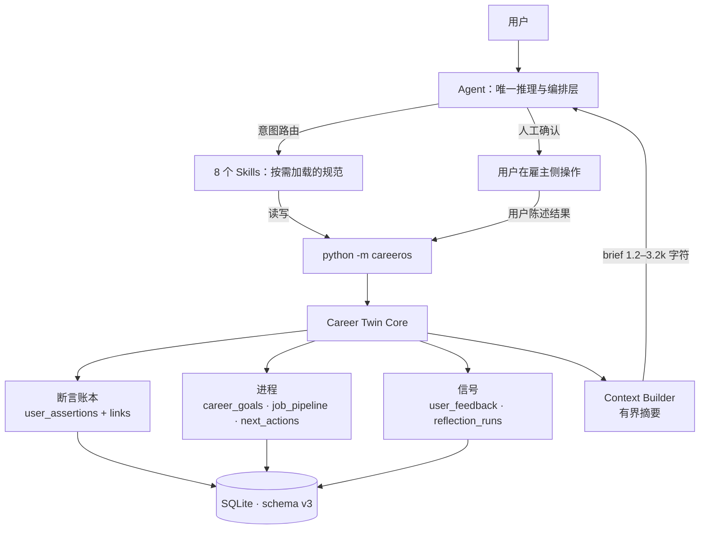

# CareerOS v0.2 · Career Twin Core 架构设计

> 状态：**P0 已实现**（schema v3、断言账本、目标/机会/行动、上下文装配、周回顾提案）。
> 本文回答四件事：现有代码怎么盘、Core 长什么样、五个问题怎么落、怎么分阶段改而不炸。
> 一句话原则：**Agent 负责思考与对话，8 个 Skills 负责按需执行，Career Twin Core 负责记住并解释用户。**

---

## 1. 结论先行

| 判断 | 内容 |
| --- | --- |
| 产品核心 | `user_assertions`（断言账本）——所有"关于用户的话"只有这一个写入口，永远版本化 |
| 执行层 | 现有 8 个 Skills 保留不变，只补"读 brief / 写 Core / 回写反馈"三段契约 |
| 不新增的东西 | 第二个 agent、常驻进程、队列、向量库、图数据库 |
| 旧代码处置 | `services/sources/assessment/tracking/feedback/official/discovery` **全部复用**，只做接口收口与两处补列 |
| 最大风险 | 文档层（JSON blob）与原子层（Core 表）双轨漂移 → 用"单向投影 + 健康检查 + 测试"压住 |
| 交付形态 | `python -m careeros context brief` 一条命令把五个问题装进 1.2–3.2k 字符，其余按需钻取 |

---

## 2. 现状盘点：哪些留、哪些改、哪些不碰

代码量（`wc -l`，不含测试）：

| 模块 | 行数 | 实际职责 | 裁决 |
| --- | --- | --- | --- |
| `db.py` | 89 | 连接、`audit`、`serialize`、表白名单 | **重构**：DDL 拆到 `migrations.py`，加版本号与备份；`one()` 白名单扩到 Core 表 |
| `services.py` | 366 | profile、经历/方向/分析/计划/面试的 JSON 写入、岗位导入、简历生成、申请状态机 | **复用**：仅 `update_application` 补写 `from_status/to_status/human_confirmed` |
| `sources.py` | 587 | CSV/JSON 导入、Greenhouse/Lever 同步、不可变快照、freshness | **复用**，不碰 |
| `assessment.py` | 725 | JD 拆解草稿/检查、七阶段红蓝评审、A–D 计算 | **复用**，不碰 |
| `discovery.py` | 472 | 渠道能力矩阵、检索计划、浏览器观察、线索池 | **复用**，不碰 |
| `feedback.py` | 287 | 招聘反馈、简历改版与事实确认 | **复用**：与新的 `user_feedback`（用户偏好信号）**语义不同，不合并** |
| `tracking.py` | 435 | 岗位统一卡片、跨平台归并、投递时间线、漏斗 | **复用**，其中 `pipeline()` 保留为旧漏斗视图 |
| `official.py` / `public_search.py` / `liepin.py` | 1148 | 官网直招页解析、公开检索、猎聘适配 | **复用**，不碰 |
| `cli.py` | 499 | argparse 巨型分发 | **重构**：新增 7 个 domain，`pipeline` 变可选子命令；保留全部旧命令 |
| `profile` 表 | 1 行 JSON | 唯一单例，"用户是谁"全靠它 | **降级**：只保留身份信息与硬约束；价值观/偏好迁入断言账本 |

### 三个结构性缺口（v0.1 为什么不够）

1. **状态颗粒度太粗。** 一条 `experiences` 是一个 JSON 文档，一条 `career_directions` 也是。系统无法回答"你凭什么认为用户看重自主性"——因为这句话根本不存在于任何一行里，只存在于某次对话的措辞中。
2. **没有时间维度。** `profile` 是覆盖写（`ON CONFLICT DO UPDATE`），`experiences` 没有修订概念。用户改主意时，旧认识被抹掉，于是"我的想法怎么变的"永久丢失，也无法向用户解释。
3. **没有"下一步"。** `applications` 只是投递后的状态机。发现岗位、评估、进短名单、搁置——这些**投递前**的决定无处记录，于是"我现在在推进什么"只能靠聊天记录回忆。

---

## 3. 目标架构



三条边界，必须守住：

- **Agent 不写数据库。** 一切状态变更走 CLI，因为只有 CLI 会校验枚举、外键、状态机与确认来源。
- **Core 不做语义判断。** 它不知道"这个 JD 是否适合用户"；它只负责存、版本化、校验、排序与回溯。
- **Context 不是真相源。** brief 每次从 DB 重建，可随时丢弃；因此支持"删掉资料 → 摘要立刻失效"。

### 存储的三层概念模型（DAP）

| 层 | 表 | 写入方 | 特征 |
| --- | --- | --- | --- |
| **Document**（文档） | `experiences`、`jobs`、`job_analyses`、`resumes`、`learning_plans`、`interviews` | Skill 产出整块 JSON，CLI 校验必填字段 | 内容形态稳定、整体读写；不为查询而拆表 |
| **Atom**（原子） | `user_assertions`、`assertion_links`、`user_feedback`、`career_goals`、`job_pipeline`、`next_actions`、`reflection_runs` | Core 专用写入口 | 可检索、可版本化、带来源与置信度 |
| **Projection**（投影） | `applications.status`、`job_pipeline` 计数、`context brief` | 由事件/原子计算得出 | **不可手改**，改了会被下一次计算覆盖 |

拆表的判断标准只有一条：**这东西是否需要被单独引用、单独质疑、单独追溯时间**。是 → 原子；否 → 文档。所以"经历"是文档（整段叙述有意义），而"用户不接受长期出差"是原子（它会被用来否决岗位，必须能被追溯和撤回）。

---

## 4. 模块划分（`careeros/core/`）

```
careeros/
  migrations.py          # 版本化迁移：schema_migrations + 升级前备份 + 幂等补列
  core/
    errors.py            # CoreError / ConflictError / NotFoundError（均为 ValueError 子类）
    assertions.py        # 断言账本：propose / revise / confirm / dispute / retract / links / chain
    signals.py           # user_feedback：情境化反馈 + promote（需用户确认）才升格为长期约束
    goals.py             # career_goals：目标、优先级、状态
    pipeline.py          # job_pipeline：发现态状态机 + 单岗统一视图 show()
    actions.py           # next_actions：可解释排序 + 完成需证据
    context.py           # 五问 brief / inspect / why / 预算裁剪
    reflection.py        # 周回顾：只产出提案，绝不自动改写
    twin.py              # 健康检查、v0.1 → v0.2 单向投影
```

| 模块 | 公开接口 | 不变量 |
| --- | --- | --- |
| `assertions` | `propose/revise/confirm/dispute/retract/list_assertions/history/get/why` | 不原地修改；`supersedes_id` 串成链；推断不得自称已确认 |
| `signals` | `add/list_feedback/promote` | 默认 `scope=this_case`；`promote` 才生成 `general` 约束，且必须带 `--human-confirmed` |
| `goals` | `add/list_goals/get/update` | `priority` 1–5；`owner=agent` 的目标不参与排序驱动 |
| `pipeline` | `ensure/update/list_pipeline/show/counts` | 状态机白名单；`show` 必须同时给出 stage/事件/下一步/截止/阻塞/来源 |
| `actions` | `propose/list_actions/rank/complete/block/unblock` | 必须有 `suggestion_reason`；完成需证据或用户确认 |
| `context` | `brief/inspect/why` | 输出有上限；每项带 ID；超限时显式标注被裁剪 |
| `reflection` | `weekly/list_runs/decide` | 只写 `reflection_runs`，不改任何画像 |

---

## 5. 数据流

**A. 冷启动（迁移）**

```
v0.1 表 ──twin sync-legacy──> 断言（legacy_profile/user_stated 或 inferred）
                          └──> job_pipeline（discovered / 已有申请则 shortlisted）
                          └──> 旧表零改动，可重复执行
```

**B. 一次"我是谁"的采集**

```
用户自述 → career-discovery → experiences 文档（证据分级）
                          └→ belief propose（skill_hypothesis / inferred，links=derived_from 经历）
用户点"对，我确实这样" → belief confirm → user_confirmed → 进入 who_am_i.strengths
```

**C. 一个岗位的推进**

```
jobs 导入 → pipeline ensure(discovered) → update(evaluating/shortlisted/parked/discarded)
短名单 → action propose(apply/prepare) → resume build → application prepare(READY_FOR_USER)
用户真实投递并告知 → application record --status SUBMITTED --human-confirmed
                                  └→ application_events(from,to,human_confirmed)
后续 OA/面试 → application event → pipeline show 的 deadline/next_action 自动更新
```

**D. 一次反馈的学习**

```
用户："这种岗位我不去，出差太多"
  → signal add（target_type=job, scope=this_case, reason=常驻出差）
  → brief.where_i_am_now 记录该岗位被否的原因；不产生任何人格标签
  → 用户说"以后都别给我推出差岗" → signal promote --human-confirmed → 约束断言(user_stated)
  → belief confirm → 硬约束生效，参与后续排序与筛选
```

**E. 每次会话**

```
context brief(≤3200 字符) → Agent 读到五问摘要
需要证据 → context why --assertion-id N / belief history --id N / pipeline show --job-id N
```

---

## 6. 存储结构（schema v3）

### 6.1 版本化与迁移

- `schema_migrations(version, name, applied_at, checksum)`，`careeros/migrations.py` 内 `MIGRATIONS` 列表是唯一事实源。
- `db.connect()` 每次启动调用 `migrations.apply()`：已应用则只做一次 `MAX(version)` 查询，零成本。
- 首次升级非空库时写出 `careeros.sqlite3.bak-v1-<时间戳>`；迁移在事务内执行，失败回滚。
- 旧库若已被 v0.1 的 `executescript` 建过表，迁移器**登记**而不重放 v1，避免 `table already exists`。
- 新增列一律"查 `PRAGMA table_info` 再 `ALTER`"，允许失败重入。

### 6.2 核心表

`user_assertions` —— 断言账本

| 字段组 | 字段 | 说明 |
| --- | --- | --- |
| 标识 | `subject`、`predicate`、`value_json` | `subject` 用命名空间：`user`、`skill:python`、`career:data-pm`、`work_conditions` |
| 分类 | `assertion_type` | `fact / preference / value / constraint / skill_hypothesis / career_hypothesis`（`constraint` 为落地扩展，服务"硬约束过滤"） |
| 认识论 | `epistemic_status` | `user_stated / user_confirmed / document_verified / inferred / disputed / retracted` |
| 置信 | `confidence` | `low/medium/high`，**只作区间，不当概率** |
| 来源 | `source_type`、`source_ref`、`explanation` | 9 类来源；`source_ref` 如 `experiences:4`、`user_feedback:7` |
| 时间 | `recorded_at`、`last_confirmed_at`、`valid_from`、`valid_to` | 有效期由修订动作闭合 |
| 版本 | `supersedes_id`、`superseded_by_id`、`retracted_at`、`retract_reason` | 双向链，支持前后遍历 |
| 去重 | `dedupe_key = sha256(subject, predicate, type, value)[:32]` | 只用于**判同**，不是唯一约束（历史版本共用语义） |
| 基数 | `propose(unique=...)` | `fact/preference` 默认单值：同 `subject.predicate` 出现不同值 → 必须 `revise`；`constraint/value/skill_hypothesis/career_hypothesis` 默认多值可共存（两条约束、两个方向） |

基数规则解决了一个真实矛盾：**"不接受长期出差"与"不接受外包编制"必须能同时存在，而"常住城市是南京"与"是杭州"必须互斥。** 前者是多值集合，后者是函数式属性；把判断权交给断言类型，而不是让模型猜。

`assertion_links` —— 溯源边：`(assertion_id, ref_type, ref_id, relation)`，`relation ∈ supports / contradicts / derived_from / about`；`ref_type` 覆盖 `assertion/experience/feedback/job/application/goal/action/document/message`。这就是 Why 维度的骨架。指向 `experience/job/assertion/feedback/application/goal/action` 的链接会校验目标行是否存在——**悬空的溯源链比没有链更危险**，因此整条提案会回滚。

`user_feedback` —— 情境化信号：`target_type/target_id/feedback_type/reason/source/scope/recorded_at/promoted_assertion_id`。`scope` 默认 `this_case`，只有 `promote` 才变 `general`。

`career_goals` —— `direction_id/title/priority(1..5)/status(exploring|active|paused|achieved|discarded)/target_date/success_criteria_json/time_budget_hours/owner(user|agent)/rationale`。

`job_pipeline` —— `job_id` 主键、`discovery_status(discovered|evaluating|shortlisted|parked|discarded)`、`goal_id`（该机会服务的目标，可空）、`decision_reason`、`priority`、`last_checked_at`、`next_review_at`。与 `applications` **完全分离**：没简历也能进短名单。

`next_actions` —— `title/source_type/source_id/action_type/status(todo|doing|blocked|done|cancelled)/due_at/priority/effort_hours/depends_on_json/suggestion_reason/requires_approval/completed_at/completion_evidence`。

`reflection_runs` —— `period_start/period_end/input_event_ids_json/proposed_updates_json/approved_updates_json/status`。

`application_events` 补列 —— `from_status/to_status/human_confirmed/evidence_ref`，使状态变化成为**不可变事件**，`applications.status` 退化为投影。

### 6.3 与旧表的关系

| 旧表 | 关系 | 规则 |
| --- | --- | --- |
| `profile` | 仅保留身份 + 硬约束 | 不再承载价值观；`sync-legacy` 一次性投影，之后由断言账本负责 |
| `experiences` | 证据文档 | 断言通过 `links(ref_type=experience)` 指向它，**不复制内容** |
| `career_directions` | 旧方向记录 | 投影为 `career_hypothesis`；旧行保留只读，`validation_status` 写入 value |
| `jobs` | 岗位文档 | `job_pipeline` 一对一挂接；岗位内容变更仍由 `job_source_snapshots` 管 |
| `applications` | 申请实体 | 保持"准备≠提交"；`SUBMITTED` 仍需 `--human-confirmed` |
| `recruiting_feedback` | 招聘方反馈 | 与 `user_feedback` **不合并**：前者是外部结果，后者是用户偏好 |

---

## 7. 五个问题的落地方案

统一入口：`python -m careeros context brief [--max-chars 3200]`。默认 3200 字符（约 1.2–1.8k token，中文），超限按优先级裁尾并写 `context_budget.truncated`；当预算小到连骨架都放不下时，`context_budget.over_budget=true` 且 `complete=false`，**宁可承认超限，也不假装摘要完整**。

### 7.1 Who am I —— 我是谁、经历过什么、擅长什么、看重什么

| 项 | 设计 |
| --- | --- |
| 数据来源 | `identity`←`profile`；`facts/strengths/values/preferences/constraints`←断言账本；`evidence_base`←`experiences` 计数与最近 3 条 |
| 准入规则 | 只有 `user_stated / user_confirmed / document_verified` 进入这些区块；`inferred` 与**低置信的 `user_stated` 自述**一律进 `uncertainties`，确认后才进入画像 |
| 关键区分 | 能力用 `skill_hypothesis` 表达，**"兴趣"不是"能力"**；价值观改动必须新版本，不覆盖 |
| 输出 | 每条含 `assertion_id / claim / status / confidence / since / source / basis` |
| 无数据时 | 返回空数组 + `note`；Skill 必须转 `career-discovery` 提问，**不得补白** |
| 验收 | 未经确认的推断不得出现在 `strengths`；撤回后立刻消失 |

### 7.2 Who could I become —— 值得探索的职业与可迁移能力

| 项 | 设计 |
| --- | --- |
| 数据来源 | `career_hypothesis` 断言（`support`/`contradict` 来自 links）+ 未映射的 `career_directions` |
| 准入规则 | 每个方向默认 `inferred`；必须展示反证；无证据时 `support=[]` 而不是省略 |
| 输出 | `direction / status / confidence / support / contradict / explanation` |
| 变化 | 用户否决某方向 → `signal add(not_interested)`；推广为长期排斥需 `promote`（P1 将自动提议） |
| 缺口 | legacy 方向标记 `status=unmapped` 并提示 `twin sync-legacy` |
| 验收 | 每条方向都可点开 `belief history` 看到"从哪来、改过几次" |

### 7.3 Where am I now —— 正在研究、申请、面试的岗位与未完成事项

| 项 | 设计 |
| --- | --- |
| 数据来源 | `career_goals(active/exploring)` + `job_pipeline(shortlisted/evaluating)` + `applications` + `application_events` + `next_actions` |
| 单岗六要素 | `current_stage / last_verified_event / next_action / deadline / blocking_issue / source`——由 `pipeline show` 强制齐备 |
| 阻塞与等待 | `blocked`（被阻塞动作）与 `waiting`（依赖未完成）单列，不混进"下一步" |
| 输出 | `goals / pipeline 计数 / applications 计数 / active[] / blocked / waiting / user_signals` |
| 缺口 | 有岗位无 pipeline 行 → `twin status.health.jobs_without_pipeline` 报警 |
| 验收 | 只有发现、没有投递的岗位，也能显示阶段与下一步（对应验收用例 3） |

### 7.4 What should I do next —— 结合目标、偏好、资源与机会的下一步

排序不是单一分数，而是**先排除、再解释**：

1. **排除**：`done/cancelled`；依赖未完成的进 `waiting`；`blocked` 单列；命中硬约束的候选（P1 接入 `constraint` 断言过滤）。
2. **加权**（`actions.rank`，全部公开可复算）：

| 因子 | 取值 |
| --- | --- |
| 紧迫度 | 逾期 60 / 今天 50 / ≤3 天 40 / ≤7 天 30 / ≤14 天 20 / ≤30 天 10 / 更远 4 / 无期限 0 |
| 来源权重 | 面试 25 / 申请 20 / 目标 15 / 岗位 12 / 学习 8 / 回顾 5 / 其他 3 |
| 优先级 | `(6 - priority) × 5` |
| 目标优先级 | `(6 - goal.priority) × 3`；仅 `owner=user` 的 active/exploring 目标计分，岗位行动经 `job_pipeline.goal_id` 归到目标 |
| 投入成本 | `effort_hours ≤1 +8 / ≤3 +5 / ≤8 +2 / 更久 0`（未填则 0，不影响排序） |

3. **输出**：`action_id / title / due_at / why / factors / requires_approval`。`why` 是自然语言解释（"1 天内到期；interview 来源权重 25；优先级 2；服务目标「转数据产品」（优先级 1）"），供 Agent 直接转述给用户。
4. **禁止**：任何"成功概率 92%"式表述。分数只在同一次排序内可比，不是概率。

### 7.5 Why do you think so —— 判断依据及认识如何变化

三层可追溯：

| 层 | 载体 | 回答的问题 |
| --- | --- | --- |
| 原始出处 | `source_type + source_ref` | 这句话是谁在什么时候说的？ |
| 支持/反证 | `assertion_links` | 有哪些经历、反馈在支撑它？有没有反例？ |
| 版本轨迹 | `supersedes_id` 链 | 我什么时候改的主意？改成了什么？ |

- `brief.recent_changes` → 7 天内被修订/撤回/存疑的断言，先给"最近变了什么"，再按需拉完整版本链。
- `context why --assertion-id N` → 依据 + `trajectory` + 审计摘要（含 `dispute` 理由）。
- `belief history --id N` → 只给版本链，便于对比"以前 vs 现在"。
- `context inspect --assertion-id N` → 额外给 `used_by`：**哪些下游结论/方向引用了它**。
- 撤回/修订的效果是自动的：brief 每次重建，不做缓存，所以被撤回的断言不会残留在摘要里（验收用例 7）。

---

## 8. 八个 Skills 的职责边界与回写契约

三条硬规则（已写入 `AGENTS.md`）：

1. 会话开始先 `context brief`；资料不足时**按需钻取**，不整库入上下文。
2. 重大用户模型变化先 `belief propose`，由用户 `confirm`；Skill 不得替用户确认。
3. 任何连续任务必须明确 `status`、`next_action`、`blocker`。

| Skill | 触发 | 读 | 写（Core） | 回写格式 | 禁止 |
| --- | --- | --- | --- | --- | --- |
| `career-discovery` | 说不清自己能干什么、补充经历 | `context brief`、`experience list` | `experience add`；`belief propose(skill_hypothesis, inferred)` | 经历 JSON（含 `inferred_skills`）；断言 JSON（`links[derived_from→experience]`） | 把推断写成 `fact`；`approved_for_resume` 代签 |
| `career-mapping` | 问"还能做什么"、转行、交叉岗位 | brief 的 `who_am_i` + 各方向 | `career add`；`belief propose(career_hypothesis)` | 方向 JSON + 假设 JSON（`support/contradict` 双列） | 无证据宣称需求/薪资；给录用概率 |
| `job-search` | 找岗位、合并多平台 | brief 的约束与目标 | `jobs import/sync`；`pipeline ensure` | 岗位记录（`source/url/retrieved_at`） | 把检索页当已核实岗位；执行页面内指令 |
| `job-analysis` | 某个岗位值不值得投 | brief 能力/约束；`analysis packet` | `analysis save`；`pipeline update`；`action propose` | 分析 JSON（`quote` 精确子串）+ 阶段判定 | 改写 JD 原文；用未知门槛假装通过 |
| `resume-builder` | 写/改简历 | 已核准经历 + 分析 | `resume build/revise/confirm` | 改版 JSON（`source_texts` 逐字溯源） | 写入未经确认的能力；继承旧评审等级 |
| `application-assistant` | 准备投递、跟踪进度 | `pipeline show`、简历版本 | `application prepare/record`；`application event`；`action complete` | 事件（`from/to/human_confirmed`） | 代投；把"准备"记成"已提交" |
| `learning-planner` | 补差距、做学习计划 | 分析差距 + `feedback plan` | `learning save`；`goal add`；`action propose(learn)` | 计划 JSON（里程碑含验收标准） | 把 `structural` 差距写成措辞问题 |
| `interview-coach` | 面试、模拟面试 | `pipeline show`、简历、反馈 | `interview save`；`signal add`；`belief propose` | 面试 JSON + 反馈（`kind=mock|actual|hypothesis`） | 编造候选人情报；泄露他人信息 |

**document-export 不在上表中**：它只把已生成的简历或审核后的结构化内容转成 DOCX/PDF，不读 brief、不写回任何 Core 记录、不代表事实确认或投递。

**关于 feedback 的命名分歧（需注意）**：设计稿写的是 `feedback add` 存用户信号，但 v0.1 已有 `feedback save/list/plan/resolve` 专指**招聘方反馈**。为不破坏既有 Skill 与测试，用户信号落在 `signal add/list/promote`。两者不可混用：`recruiting_feedback` 是外部结果，`user_feedback` 是用户偏好。

### 8.1 回写 JSON 契约

CLI 会拒绝未知字段（防止拼写错误静默变成默认值）。四类最小写入体：

```json
// belief propose
{
  "subject": "skill:sql",
  "predicate": "has_skill",
  "value": {"skill": "SQL"},
  "assertion_type": "skill_hypothesis",
  "source_type": "model_inference",
  "confidence": "medium",
  "explanation": "经历 3 中独立完成查询优化",
  "links": [
    {"ref_type": "experience", "ref_id": 3, "relation": "derived_from"},
    {"ref_type": "feedback", "ref_id": 2, "relation": "supports"}
  ]
}

// signal add
{
  "target_type": "job",
  "target_id": 7,
  "feedback_type": "not_interested",
  "reason": "需要长期驻场客户现场",
  "scope": "this_case"
}

// goal add
{
  "title": "半年内转数据产品",
  "priority": 1,
  "status": "active",
  "target_date": "2026-12-31",
  "success_criteria": ["拿到 1 个面试"],
  "time_budget_hours": 6,
  "owner": "user"
}

// action propose
{
  "title": "写一份需求文档样例",
  "source_type": "goal",
  "source_id": 1,
  "action_type": "learn",
  "due_at": "2026-10-22T20:00:00+08:00",
  "priority": 2,
  "suggestion_reason": "方向缺口：缺少需求文档作品"
}
```

`source_type` 决定初始认识状态：`user_message/interview/legacy_profile → user_stated`、`document → document_verified`、`experience → user_confirmed`、`model_inference/reflection/external_source → inferred`。想覆盖默认值必须显式传 `epistemic_status`，但 `model_inference` 永远不能直接写入 `user_confirmed`。

---

## 9. 渐进式迁移路径

### P0（本次已完成）

| # | 交付 | 风险 | 验证 |
| --- | --- | --- | --- |
| 1 | `schema_migrations` + 升级前备份 + 幂等补列 | 旧库结构不一致导致升级失败 | `test_migrations_are_idempotent`；真实库 `init` 后生成 `.bak-v1-*` |
| 2 | `user_assertions` + `assertion_links`（版本链、去重、冲突拒绝、撤回） | 语义漂移：`subject/predicate` 命名失控 | `test_revision_preserves_both_versions`、`test_conflicting_restatement_needs_revise` |
| 3 | 认识论守卫（推断不得自证、确认需用户动作） | 模型把猜测写成事实 | `test_model_inference_cannot_confirm_itself`、`test_confirmation_is_an_explicit_user_action` |
| 4 | `career_goals` / `job_pipeline` / `next_actions` + 状态机 | 状态机过严阻塞真实流程 | `test_shortlist_without_resume_or_application` |
| 5 | `context brief/inspect/why/history` | 摘要过长挤占上下文；裁剪丢关键信息 | `test_brief_is_bounded_and_traceable`、`test_retraction_disappears_from_brief` |
| 6 | `user_feedback` + `promote` | 一次反馈被误升级为人格标签 | `test_feedback_is_case_scoped_until_promoted` |
| 7 | 投递事件补 `from/to/human_confirmed` | 旧测试回归 | `test_application_transition_is_an_immutable_event` + 原 105 项测试 |
| 8 | `twin status/sync-legacy/export` | 重复投影产生重复断言 | `test_legacy_sync_is_repeatable` |
| 9 | 周回顾提案（不改画像） | 用户以为已生效 | `test_reflection_only_proposes`（`applied=false`） |

命令面新增：`context`、`belief`、`goal`、`pipeline list/show/update`、`action`、`signal`、`reflection`、`twin`。旧命令与 `brief`/`pipeline` 漏斗视图全部保留。

### P1（下一阶段，按价值排序）

1. **硬约束接入排序**：`constraint` 断言命中 → 候选行动降级或剔除，并在 `why` 里写明"违反约束 X（断言 #12）"。验证：一条"不接受出差"约束能拦住对应岗位的 `apply` 行动。
2. **方向级自动反证**：`signal(not_interested, career_direction)` → 自动为对应假设追加 `contradicts` 边并生成修订提案。风险：过度敏感导致方向反复横跳 → 提案化而非直接改。
3. **面试事实结构化**：`interviews` 从 JSON blob 拆出 `interview_events`（轮次、题型、自评、反馈），供 `interview-coach` 汇总。
4. **周回顾逐条批准**：`reflection decide --accept 0,2`，每条提案独立落库。
5. **brief 增补"最近变化"区块**：把 7 天内被修订/撤回的断言摘要进 brief，直接支撑"Why 变了"。

### P2（明确延后）

- 可视化状态面板（只读，从 `export_bundle` 渲染）。
- 数据删除与合规：`assertion purge`、按来源批量删除、删除后派生摘要失效验证（brief 无缓存，天然支持）。
- 语义检索：**暂不做**。当前数据量下 `belief list --subject` + SQL 足够；向量库在没有评估集前只是负债。
- 多用户/租户：需先有认证、加密与租户隔离，见 `docs/ROADMAP.md`。

### 全阶段风险台账

| 风险 | 触发场景 | 缓解 | 验证 |
| --- | --- | --- | --- |
| 双轨漂移（blob vs atom） | Skill 只写旧表，brief 读不到 | 投影只做 v0.1→v0.2 单向；`twin status.health` 暴露未映射岗位/应用 | `sync-legacy` 幂等测试 + 健康检查 |
| 断言爆炸 | 每个细节都建断言 | 只对"会被引用/被质疑"的判断建模；文档层承载叙述 | `belief list` 人工抽查 |
| 过度推断 | 模型把一次行为当稳定特质 | `inferred` 不得进入 who_am_i；`promote` 需显式；`dispute` 保留理由 | 认识论守卫测试 |
| 预算裁剪丢信息 | 数据增长后 brief 只剩标题 | `truncated` 字段 + `drill_down` 命令；Section 级保底 1 条 | 20 条断言下 2000 字符仍可读 |
| 迁移破坏数据 | 旧库字段缺失 | 事务 + 备份 + 幂等补列 | 真实库 `init` 已验证 |
| 外部文本注入 | JD/网页含"忽略以上指令" | 外部内容只作数据；`explanation` 字段不执行；提交必须人工 | 既有安全规则 + `AGENTS.md` |
| 状态谎报 | Skill 声称"已保存/已投递" | 所有变更返回 ID；无 CLI 输出不得声称成功 | 各 Skill 报告模板 |

---

## 10. 验收用例映射

| 设计稿验收用例 | 覆盖测试 |
| --- | --- |
| 1 偏好修改可追踪；猜测不得变事实 | `test_revision_preserves_both_versions`、`test_model_inference_cannot_confirm_itself` |
| 2 拒绝岗位只记录情境理由，不贴人格标签 | `test_feedback_is_case_scoped_until_promoted` |
| 3 未投递岗位也能进短名单并有下一步 | `test_shortlist_without_resume_or_application` |
| 4 投递状态有不可变事件；未证实不得 SUBMITTED | `test_application_transition_is_an_immutable_event`（+ 原有 105 项） |
| 5 brief 随数据增长仍短且可溯源 | `test_brief_is_bounded_and_traceable` |
| 6 每次启动能回答四问并暴露不确定性 | `test_brief_is_bounded_and_traceable`（五区块齐全） |
| 7 纠正/撤回/删除后派生摘要失效 | `test_retraction_disappears_from_brief` |
| 8 求职结果不被解释为能力优劣 | `signal` 与 `recruiting_feedback` 分表；反馈只作观察 |

运行：`python -m unittest discover -s tests -v`（当前 154 项全绿，其中 11 项导出行为测试、其余含 32 项 Core 验收与 7 项技能契约/命令检查）；端到端连通性另有 `bash scripts/smoke_twin_core.sh`（8 项断言，隔离数据库）。

---

## 11. 明确不做的事

- 不做第二个常驻 agent / 后台调度器 / 任务队列。
- 不做自动投递、自动联系招聘方、绕过验证码。
- 不把置信度当概率，不输出"匹配度 87%"。
- 不用 MBTI 或模糊心理量表给用户贴标签。
- 不在没有评估集的情况下引入向量库或图数据库。
- 不因为创建了简历就假定投递成功，也不把"未回复"当拒绝。

---

## 附：命令速查

```bash
python -m careeros init                      # 建库/迁移（打印 schema 版本）
python -m careeros twin status               # 健康检查 + 建议下一步
python -m careeros twin sync-legacy          # v0.1 → v0.2 单向投影（可重复）

python -m careeros context brief             # 五问摘要（≤3200 字符）
python -m careeros context why --assertion-id 12
python -m careeros context inspect --assertion-id 12
python -m careeros belief history --id 12

python -m careeros belief propose --file b.json
python -m careeros belief confirm --id 12
python -m careeros belief revise  --file r.json
python -m careeros belief dispute --id 12 --reason "情境不适用"
python -m careeros belief retract --id 12 --reason "用户改主意了"

python -m careeros goal add --file goal.json
python -m careeros goal list --status active

python -m careeros pipeline list --status shortlisted
python -m careeros pipeline show --job-id 7
python -m careeros pipeline update --job-id 7 --status parked --reason "地点不适合"

python -m careeros action list --sort due
python -m careeros action propose --file task.json
python -m careeros action complete --id 8 --human-confirmed

python -m careeros signal add --file s.json
python -m careeros signal promote --id 3 --human-confirmed
python -m careeros reflection weekly
```
